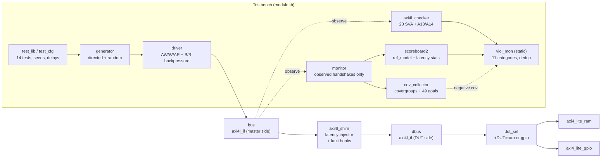
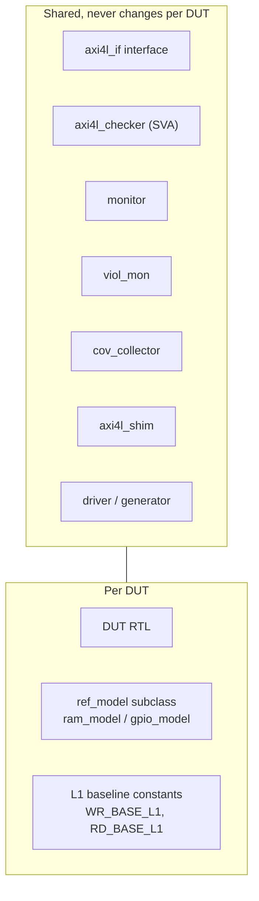
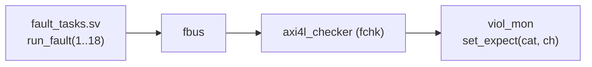
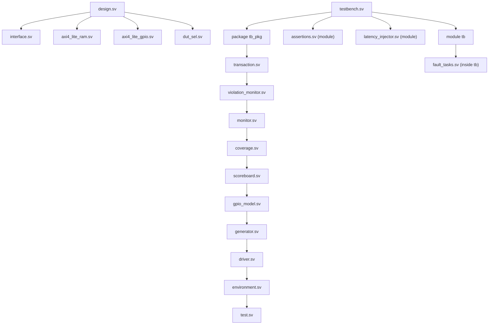
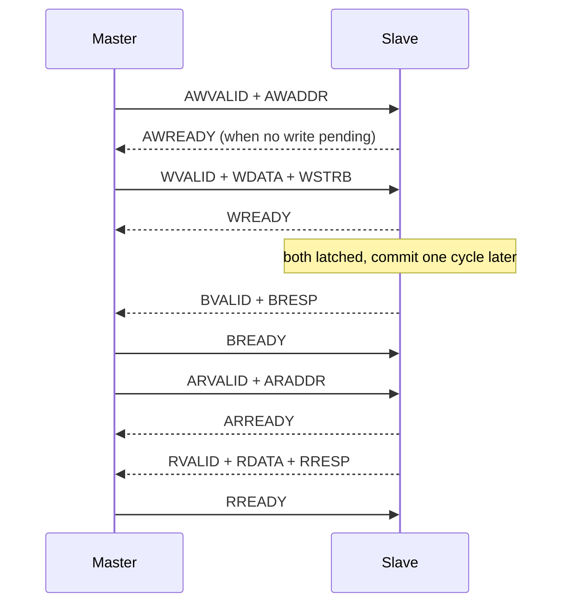
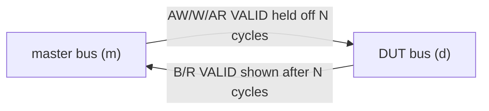
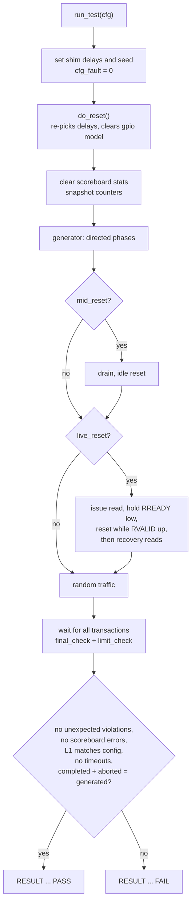
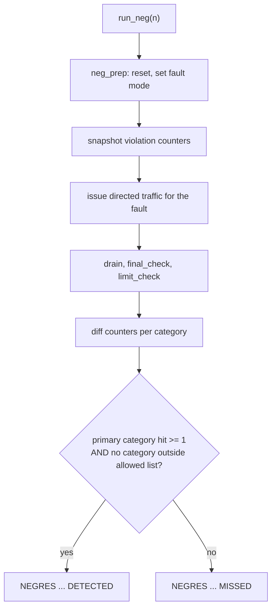
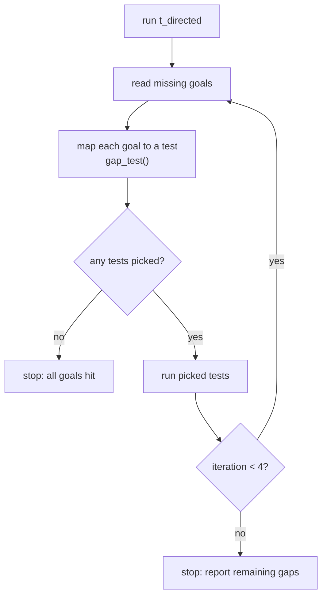

# DUT-Agnostic AXI4-Lite Compliance Checker with Latency Injection and Violation-Coverage Closure

A reusable, transaction-based SystemVerilog verification framework for AXI4-Lite slave devices.
It checks protocol compliance, data correctness, latency behaviour and functional coverage
**without modifying the DUT** and **without UVM**. The whole project builds and runs on
[EDA Playground](https://www.edaplayground.com) with **Cadence Xcelium 25.03**. No local tools,
scripts or installations are required.

The same checker, monitor, coverage collector and latency injector are used unchanged on two
different DUTs (an AXI4-Lite RAM and an AXI4-Lite GPIO block). Only the reference model differs.

---

## Table of contents

1. [Highlights](#1-highlights)
2. [Architecture](#2-architecture)
3. [File map and compile order](#3-file-map-and-compile-order)
4. [DUTs](#4-duts)
5. [Component descriptions](#5-component-descriptions)
6. [Latency injection and metrics](#6-latency-injection-and-metrics)
7. [Assertions](#7-assertions)
8. [Violation monitor](#8-violation-monitor)
9. [Test suite](#9-test-suite)
10. [Negative testing](#10-negative-testing)
11. [Functional coverage and gap closure](#11-functional-coverage-and-gap-closure)
12. [Regression output format](#12-regression-output-format)
13. [EDA Playground setup](#13-eda-playground-setup)
14. [Run options](#14-run-options)
15. [Verified results](#15-verified-results)
16. [Integrating a new AXI4-Lite slave](#16-integrating-a-new-axi4-lite-slave)
17. [Design decisions and lessons learned](#17-design-decisions-and-lessons-learned)
18. [Limitations](#18-limitations)
19. [Resume summary](#19-resume-summary)

---

## 1. Highlights

| Area | What is implemented |
|---|---|
| Protocol checking | 20 concurrent SVA assertions plus 2 procedural response-tracking checks, all on interface signals only |
| Stimulus | Directed and constrained-random legal traffic, boundary addresses, byte strobes, RAW and WAW, independent AW/W arrival, reproducible seeds |
| Monitoring | Passive monitor that rebuilds transactions from observed handshakes only |
| Checking | Scoreboard with an independent reference model per DUT (RAM, GPIO) |
| Latency | Legal latency-injection shim: 0, 1, 2, 5, 10 cycles and seeded random, per channel |
| Backpressure | Driver holds BREADY and RREADY low for 0 to 10 cycles |
| Violations | 11 categories, dedup policy, expected-vs-unexpected tracking |
| Negative tests | 9 DUT-path fault tests, each passes only if the intended category is hit |
| Assertion proofs | 18 fault scenarios on a separate fault bus prove assertions can fire |
| Coverage | Native covergroups with crosses plus a 49-goal tracker with gap report |
| Closure | Gap-driven loop that picks tests from the missing goals (fixed gap-to-test map) |
| Reset | Idle reset and reset under live traffic (stalled read response) |
| Reuse | One checker, two DUTs |
| Reporting | CSV-style `RESULT` line per test, regression summary, coverage and violation summaries |

---

## 2. Architecture

### 2.1 Block diagram



### 2.2 DUT-agnostic split



The protocol checker observes only the nine AXI4-Lite signal groups of `axi4l_if`.
It never reads DUT memory, registers or state machines.

### 2.3 Fault bus (assertion proofs)

A second interface `fbus` has its own reset `FRST` and its own `axi4l_checker` instance.
No DUT is attached. Hand-driven pins inject one illegal behaviour at a time. This proves each
assertion can fire, independent of any DUT.



---

## 3. File map and compile order

### 3.1 Files

**Design side**

| File | Purpose |
|---|---|
| `design.sv` | Includes `interface.sv`, `axi4_lite_ram.sv`, `axi4_lite_gpio.sv`, `dut_sel.sv` |
| `interface.sv` | `axi4l_if` with `master`, `slave`, `monitor` modports. No ID signals (AXI4-Lite has none) |
| `axi4_lite_ram.sv` | Parameterizable RAM slave, 16 words by default |
| `axi4_lite_gpio.sv` | GPIO slave, 8 words |
| `dut_sel.sv` | Wraps RAM and GPIO behind one slave port, selected by `+DUT` |

**Testbench side**

| File | Purpose |
|---|---|
| `testbench.sv` | `package tb_pkg`, top module `tb`, test runner, negative-test runner, closure loop |
| `transaction.sv` | Stimulus transaction class (`op_e`, address, data, strobe, delays, TB-internal id) |
| `generator.sv` | Directed sequences and constrained-random traffic |
| `driver.sv` | AXI4-Lite master driver with bounded waits and reset awareness |
| `monitor.sv` | `obs_txn` and passive `monitor` class |
| `scoreboard.sv` | `ref_model` base, `ram_model`, `scoreboard` with latency statistics |
| `gpio_model.sv` | GPIO reference model |
| `violation_monitor.sv` | `vcat_e` categories and static `viol_mon` class |
| `coverage.sv` | `cov_collector`: covergroups, goal tracker, gap report |
| `assertions.sv` | `axi4l_checker` module (SVA + procedural checks) |
| `latency_injector.sv` | `axi4l_shim` module (latency plus verification-only fault hooks) |
| `environment.sv` | `scoreboard2` and `environment` classes |
| `test.sv` | `test_cfg`, `test_lib`, gap-to-test map |
| `fault_tasks.sv` | Fault-bus driver tasks, included inside `module tb` |

### 3.2 Compile order

Only `design.sv` and `testbench.sv` are on the simulator command line. Everything else is pulled in with
`` `include ``, and every file has include guards, so order is explicit and tool independent.



The package provides one shared scope and a fixed class order. The checker and shim are modules, so they sit
outside the package.

---

## 4. DUTs

### 4.1 AXI4-Lite RAM (`axi4_lite_ram`)

- 32-bit address and data, `DEPTH` words (16 in tests, valid byte addresses `0x00` to `0x3C`)
- All five channels, one outstanding write and one outstanding read
- AW and W accepted independently, in any order and with any gap
- Byte write strobes, strobe `0000` leaves memory unchanged
- Response payload registered, so it is stable under backpressure
- Out-of-range read or write returns `SLVERR`, writes nothing, read data zero
- Reset clears handshake state. Memory is not cleared by reset (like real RAM), so the reference model persists across reset

### 4.2 AXI4-Lite GPIO (`axi4_lite_gpio`)

| Word | Byte address | Register | Access |
|---|---|---|---|
| 0 | `0x00` | OUT | RW, byte strobes |
| 1 | `0x04` | IN | RO, constant `32'hA5C30F1E` |
| 2 | `0x08` | DIR | RW, byte strobes |
| 3 | `0x0C` | ID | RO, `32'h600D0001` |
| 4 to 7 | `0x10` to `0x1C` | reserved | read zero, write ignored, OKAY |
| 8 and up | `0x20` and up | none | `SLVERR` |

OUT and DIR clear on reset, and the model clears with them. IN is a constant. No test varies it.

### 4.3 Write and read handshake of both DUTs



---

## 5. Component descriptions

### Transaction and generator
- `transaction` holds op, address, data, strobe, per-channel delays (`aw_dly`, `w_dly`, `ar_dly`), response backpressure (`bready_dly`, `rready_dly`) and idle gap. The `id` field is testbench-only and never reaches the bus.
- Directed sequences: `directed_basic`, `directed_boundary`, `directed_strobe`, `directed_raw_waw`.
- Random traffic uses a per-transaction seed (`seed + num_gen`), so a given seed gives the same stream regardless of thread order.

### Driver
- AW and W driven in parallel with independent delays (`fork/join`), so either can arrive first.
- Every wait is bounded (`timeout_cycles`, default 200).
- Drives with non-blocking assignments and samples at the clock edge, so there is no race with the DUT or monitor.
- Distinguishes a timeout from an **aborted** transaction (response lost to a reset).
- Contains one verification hook (`flt_aw_chg`) used only by the `n_payload_change` negative test.

### Monitor
- Samples every clock. Records AW, W and AR handshakes, pairs them at the response handshake.
- A response with no accepted request is marked `unexpected`.
- Stamps cycles for the three latency metrics.
- Flushes its queues when reset is seen.

### Scoreboard
- Calls `ref_model.do_write()` and `do_read()` on **observed** transactions only. Generated transactions never update the model.
- Checks response code and read data. Records latency min, avg and max for L1, L2 and L3.
- `final_check()` raises `ACCOUNTING_MISMATCH`, `MISSING_RESPONSE` and `RESPONSE_TIMEOUT`.
- `limit_check()` raises `RESPONSE_TIMEOUT` when accept-to-VALID latency exceeds 100 cycles.

### Environment and test controller
- Components are built once and live for the whole simulation. Each test sets shim delays and seed, resets the DUT (which re-picks shim delays), clears scoreboard statistics, runs a fresh generator, drains, runs final checks and prints one `RESULT` line.
- Coverage persists across tests, so goals accumulate within one simulation.

---

## 6. Latency injection and metrics

### 6.1 Shim

`axi4l_shim` sits between the master-side bus and the DUT-side bus. The DUT is untouched.



- **Request channels (AW, W, AR):** master VALID is forwarded to the DUT only after N cycles. READY back to the master is the DUT READY gated by the same hold-off. VALID stays high until the handshake, so the behaviour is legal.
- **Response channels (B, R):** DUT VALID is shown to the master only after N cycles. The DUT holds its payload, so it is stable.
- **Delay values:** any non-negative integer, or `-1` for random from `{0, 1, 2, 5, 10}` using a 16-bit LFSR seeded from the test seed, so random delays are deterministic.
- BREADY and RREADY backpressure belongs to the driver, not the shim.

### 6.2 Metrics (observed at the master-side bus)

```text
cycle:   t0                t1                  t2
         |                 |                   |
         request           response VALID      response
         handshake         first high          handshake
         |<----- L1 ------>|<------- L2 ------>|
         |<----------------- L3 = L1 + L2 ---->|
```

| Metric | Definition | Affected by |
|---|---|---|
| L1 | Last request handshake to first response VALID | B/R shim delay |
| L2 | First response VALID to response handshake | Backpressure (BREADY/RREADY) |
| L3 | Request handshake to response handshake = L1 + L2 | Both |

For writes, the request handshake is the later of the AW and W handshakes.
AW, W and AR hold-off shifts when the request handshake occurs. It does **not** change L1. It only lengthens runtime.

Measured L1 baseline at zero delay: **2 cycles (write), 1 cycle (read)** for both DUTs. The testbench checks
that L1 equals the baseline plus the injected delay exactly (fixed delay) or lies in `base .. base+10` (random).

---

## 7. Assertions

All assertions are clocked on `posedge ACLK`, use `disable iff (!ARESETN)` except the reset checks, and report through `viol_mon::report()` (no raw `$error`), so each event is printed once.

| ID | Property | Category | Proven by |
|---|---|---|---|
| A01 | AWVALID held until AWREADY | VALID_WITHDRAWAL | fault 1 |
| A02 | AWADDR stable while stalled | PAYLOAD_INSTABILITY | fault 2, `n_payload_change` |
| A03 | WVALID held until WREADY | VALID_WITHDRAWAL | fault 3 |
| A04 | WDATA/WSTRB stable while stalled | PAYLOAD_INSTABILITY | fault 4 |
| A05 | ARVALID held until ARREADY | VALID_WITHDRAWAL | fault 5 |
| A06 | ARADDR stable while stalled | PAYLOAD_INSTABILITY | fault 6 |
| A07 | BVALID held until BREADY | VALID_WITHDRAWAL | fault 7, `n_valid_withdraw_b` |
| A08 | BRESP stable while stalled | RESP_PAYLOAD_INSTABILITY | fault 8, `n_resp_unstable_b` |
| A09 | RVALID held until RREADY | VALID_WITHDRAWAL | fault 9, `n_valid_withdraw_r` |
| A10 | RDATA/RRESP stable while stalled | RESP_PAYLOAD_INSTABILITY | fault 10, `n_resp_unstable_r` |
| A11 (B, R) | Response code is not EXOKAY (`01`) | ILLEGAL_RESP_ENCODING | faults 11, 12 |
| A12 | No VALID high while in reset | RESET_RECOVERY | fault 16 |
| A12b | No VALID on first cycle after reset | RESET_RECOVERY | fault 17 |
| A13 (procedural) | BVALID needs an accepted AW and W | UNEXPECTED_RESPONSE | fault 13 |
| A14 (procedural) | RVALID needs an accepted AR | UNEXPECTED_RESPONSE | fault 14 |
| A15 | No X/Z on control signals | X_UNKNOWN | fault 15 |
| A16 (AW, W, AR, B, R) | No X on payload while VALID | X_UNKNOWN | fault 18 (AW instance) |

Sampling strategy: pre-edge values at `posedge ACLK`. Reset assumption: `ARESETN` active low, assertions disabled in reset except A12 and A12b.
Legal EXOKAY note: AXI4-Lite does not support exclusive access, so `01` is flagged. OKAY, SLVERR and DECERR are accepted.

---

## 8. Violation monitor

### 8.1 Categories

| Category | Kind | Source |
|---|---|---|
| VALID_WITHDRAWAL | PROTOCOL | A01, A03, A05, A07, A09 |
| PAYLOAD_INSTABILITY | PROTOCOL | A02, A04, A06 |
| RESP_PAYLOAD_INSTABILITY | PROTOCOL | A08, A10 |
| ILLEGAL_RESP_ENCODING | PROTOCOL | A11 |
| RESET_RECOVERY | PROTOCOL | A12, A12b |
| UNEXPECTED_RESPONSE | PROTOCOL | A13, A14, scoreboard |
| X_UNKNOWN | PROTOCOL | A15, A16 |
| MISSING_RESPONSE | TIMEOUT | `final_check` |
| RESPONSE_TIMEOUT | TIMEOUT | `limit_check`, driver bounded-wait expiry |
| ACCOUNTING_MISMATCH | ACCOUNTING | `final_check` |
| DATA_MISMATCH | DATA | scoreboard (data and response-code compare) |

`X_UNKNOWN` is an addition beyond the ten categories in the original brief.

### 8.2 Aggregation policy

- Single entry point: `viol_mon::report(category, channel, time, message, from_checker)`.
- Exact duplicates (same category, channel, time) are counted once.
- `UNEXPECTED_RESPONSE` can be seen by both the checker (A13, A14) and the scoreboard. A report from one source cancels one pending report from the other within a 200 ns window, in either order. The window is a heuristic that assumes a 10 ns clock.
- Expected-vs-unexpected: a negative test calls `set_expect(category, channel)`. Matching reports are tagged `VIOL(expected)`. Everything else counts as unexpected.
- Terms: **timeout** means a response that arrives late (L1 above 100) or a driver bounded wait that expires. **Missing** means an accepted request with no response at drain end.

---

## 9. Test suite

14 tests, seeds are `base_seed + offset`, so the same `+SEED` reproduces the same stream.

| Test | Seed offset | Directed | Random txns | Shim config | Purpose |
|---|---|---|---|---|---|
| `t_directed` | 0 | basic, boundary, strobe, raw/waw | 0 | none | Core directed functionality |
| `t_boundary` | 1 | boundary | 0 | none | First/last word, first OOR word, far OOR |
| `t_strobe` | 2 | strobe | 0 | none | Single, multi, none, full strobes |
| `t_rand` | 3 | none | 100 | none | Random legal traffic |
| `t_lat0` | 4 | all | 40 | B/R delay 0 | Latency bin 0 |
| `t_lat1` | 5 | all | 40 | B/R delay 1 | Latency bin 1 |
| `t_lat2` | 6 | all | 40 | B/R delay 2 | Latency bin 2 |
| `t_lat5` | 7 | all | 40 | B/R delay 5 | Latency bin 3 to 5 |
| `t_lat10` | 8 | all | 40 | B/R delay 10 | Latency bin 6 to 10 |
| `t_lat_rand` | 9 | all | 40 | B/R random | Random latency |
| `t_reqdly` | 10 | all | 40 | AW 3, W 5, AR 2 | Request-side hold-off |
| `t_reset` | 11 | all | 20 | none | Idle DUT reset mid-test |
| `t_rand_big` | 12 | none | 200 | none | Large random run |
| `t_reset_live` | 13 | all | 20 | none | Reset while a read response is stalled |

### 9.1 Per-test flow



### 9.2 Pass criteria per test

- Zero unexpected violations and zero scoreboard errors
- Zero driver timeouts
- L1 latency equals configured delay (or lies in range for random)
- Completed plus aborted transactions equals generated transactions
- `t_reset_live`: exactly one aborted transaction and the response really was in flight at reset. All other tests: zero aborted

---

## 10. Negative testing

Run with `+NEG=100` (all 9) or `+NEG=1` to `+NEG=9`. Faults come from the shim hooks, one driver hook and one scoreboard hook. The DUTs are never modified, and legal runs tie `cfg_fault=0`.



| Test | Injected fault | Requirement violated | Detector | Category | Result rule |
|---|---|---|---|---|---|
| `n_valid_withdraw_b` | shim hides BVALID one cycle while stalled | VALID stays until handshake | A07 | VALID_WITHDRAWAL (B) | hit >= 1 |
| `n_valid_withdraw_r` | shim hides RVALID | same | A09 | VALID_WITHDRAWAL (R) | hit >= 1 |
| `n_payload_change` | driver changes AWADDR while stalled | payload stable under backpressure | A02 | PAYLOAD_INSTABILITY | hit >= 1 |
| `n_resp_unstable_b` | shim flips BRESP while stalled | response stable | A08 | RESP_PAYLOAD_INSTABILITY | hit >= 1 |
| `n_resp_unstable_r` | shim flips RDATA while stalled | response stable | A10 | RESP_PAYLOAD_INSTABILITY | hit >= 1 |
| `n_missing_resp` | shim swallows B forever | accepted request gets a response | `final_check` | MISSING_RESPONSE | hit >= 1, RESPONSE_TIMEOUT allowed as consequence |
| `n_resp_timeout` | legal 150-cycle delay, driver bound 400 | L1 within limit | `limit_check` | RESPONSE_TIMEOUT | hit >= 1, no MISSING |
| `n_accounting` | scoreboard skips one read check | monitor count equals driver count | `final_check` | ACCOUNTING_MISMATCH | hit >= 1 |
| `n_data_mismatch` | model ignores strobes | read data matches model | scoreboard | DATA_MISMATCH | hit >= 1 |

A test passes only if its **intended** category is hit and no other category gets a hit (other than the stated consequence).

### 10.1 Assertion fault proofs (`+FAULT=100`)

Faults 1 to 18 drive the separate `fbus`. Each is checked against the expected category and channel.

| Faults | Scenario | Category |
|---|---|---|
| 1, 3, 5 | AW, W, AR VALID dropped while stalled | VALID_WITHDRAWAL |
| 7, 9 | B, R VALID dropped while stalled | VALID_WITHDRAWAL |
| 2, 4, 6 | AWADDR, WSTRB, ARADDR changed while stalled | PAYLOAD_INSTABILITY |
| 8, 10 | BRESP, RDATA changed while stalled | RESP_PAYLOAD_INSTABILITY |
| 11, 12 | EXOKAY on B, R | ILLEGAL_RESP_ENCODING |
| 13, 14 | B, R response with no request | UNEXPECTED_RESPONSE |
| 15 | X on BREADY | X_UNKNOWN |
| 16 | AWVALID high during reset | RESET_RECOVERY |
| 17 | AWVALID high on first cycle after reset | RESET_RECOVERY |
| 18 | X on AWADDR while AWVALID (handshake legal) | X_UNKNOWN |

---

## 11. Functional coverage and gap closure

### 11.1 What is covered

Coverage reads **observed bus activity only** (monitor output). Generated stimulus is never counted.

- Native covergroups `cg_wr`, `cg_rd` with crosses (backpressure x latency), and `cg_neg` for violation categories
- A 49-goal named tracker. It exists because EDA Playground has no coverage viewer, and it supports a per-goal gap report

| Group | Goals | Count |
|---|---|---|
| Operations | `OP_WR`, `OP_RD` | 2 |
| Address region | FIRST, LOW, MID, HIGH, LAST, OOR for write and read | 12 |
| Response code | OKAY, SLVERR for write and read | 4 |
| Write strobe | NONE, FULL, SINGLE, MULTI | 4 |
| Write latency (L1 minus base) | D0, D1, D2, D3_5, D6_10 | 5 |
| Read latency | D0, D1, D2, D3_5, D6_10 | 5 |
| Write backpressure (L2 minus 1) | D0, D1, D2, D3_5, D6_10 | 5 |
| Read backpressure | D0, D1, D2, D3_5, D6_10 | 5 |
| AW/W arrival order | AW first, W first, same cycle | 3 |
| Read-after-write, write-after-write, repeated address | 1 each | 3 |
| Reset observed | `RST_OBSERVED` | 1 |
| **Total** | | **49** |

Legal coverage and negative coverage are reported separately (`COV` lines vs `NEGCOV` lines).

### 11.2 Gap report

At the end of a run, `COVGAP <goal> -> try: <test>` lists each missing goal with a suggested test. `COVMASK=<hex>` can be passed to a later run with `+PRIOR=<hex>` to merge coverage across separate runs.

### 11.3 Gap-driven closure loop (`+TEST=closure`)



The map is fixed: latency bins go to `t_lat*`, `RST_OBSERVED` goes to `t_reset`, everything else goes to `t_rand_big`.
This is a **gap-driven rerun over a fixed map**. The loop does not learn and cannot invent new stimulus.

---

## 12. Regression output format

One CSV-style line per test:

```text
HDR,test,seed,gen,accepted,completed,wrL1_min/avg/max,wrL3_min/avg/max,rdL1_min/avg/max,rdL3_min/avg/max,timeouts,mismatch,viol,goals_new,goals_cum,cycles,abort,status
RESULT,t_lat5,14,82,82,82,7/7.00/7,8/9.72/18,6/6.00/6,7/8.74/17,0,0,0,2,46/49,1046,0,PASS
```

| Column | Meaning |
|---|---|
| `seed` | Seed used for this test |
| `gen` | Transactions generated |
| `accepted` | Request handshakes observed |
| `completed` | Response handshakes observed |
| `wrL1`, `wrL3`, `rdL1`, `rdL3` | Latency min/avg/max |
| `timeouts` | Driver bounded-wait expiries |
| `mismatch` | Data plus response-code mismatches |
| `viol` | Violations raised during the test |
| `goals_new`, `goals_cum` | New goals this test, cumulative goals |
| `cycles` | Simulation cycles for this test |
| `abort` | Transactions aborted by reset |
| `status` | PASS or FAIL |

Summary lines: `VSUM` (violations by category), `COV` (goals), `COVGAP`, `COVMASK`, `REGRESS` (test counts), `STAGE9` (final status),
`NEGRES` and `NEGSUM` (negative tests), `FAULT` and `FAULTSUM` (assertion proofs), `NEGCOV` and `NEGGAP` (negative coverage).
The summary is printed to the transcript. No file I/O or external script is needed.

---

## 13. EDA Playground setup

1. **Tools & Simulators:** Cadence Xcelium 25.03 (free EDA Playground login required).
2. **Language:** SystemVerilog/Verilog. **UVM:** none. **Top module:** `tb`.
3. **Tabs:** keep the two built-in tabs `design.sv` and `testbench.sv`. Use the **+** button to add one tab per remaining file listed in [section 3](#3-file-map-and-compile-order), named exactly.
4. Paste the matching code into each tab.
5. **Check every tab:**
   - Line 1 must be code. A filename glued in front of `package` or `` `ifndef `` breaks the whole compile.
   - Last lines: class files end with `endclass` then `` `endif ``. Module files end with `endmodule` then `` `endif ``. `testbench.sv` ends with `endmodule`. `fault_tasks.sv` ends with `endtask` (no include guard, it is pasted into `module tb`).
6. **Run Options** (one line, no pasted log text):

   ```text
   -coverage all -covoverwrite +access+r
   ```

   Add plusargs after it, for example `+TEST=regress +SEED=7`.
7. Tick **Open EPWave after run** for waveforms.
8. Click **Save** before **Run**. Reloading the page can restore old tab contents.

### How the simulator is invoked

The tool runs roughly:

```text
xrun -Q -unbuffered -timescale 1ns/1ns -sysv -coverage all -covoverwrite +access+r <plusargs> design.sv testbench.sv
```

`-coverage all` is required for covergroup sampling. Without it, `get_inst_coverage()` returns 0.
`+access+r` gives EPWave full object access.

### Reading the result

Expected harmless warnings: `COVDCL`, `COVMDD`, `COVUTA`, `CGPIDF`, `COVCGN`, `CGDEFN`, `COVSCE`.
Expected non-zero exit code: fault and negative-test runs intentionally trigger `ASRTST` assertion errors.
Legal runs should exit 0.
`This process not found on server` is an EPWave message after the run, not a simulation error.

---

## 14. Run options

| Option | Meaning |
|---|---|
| `+TEST=regress` | All 14 tests (default) |
| `+TEST=<name>` | One test, for example `+TEST=t_lat5` |
| `+TEST=closure` | Gap-driven loop over the fixed map |
| `+SEED=n` | Base seed (default 1) |
| `+N=n` | Override the random transaction count for tests that have random traffic |
| `+DUT=gpio` | GPIO instead of RAM (default RAM) |
| `+NEG=100` | All 9 negative tests |
| `+NEG=1..9` | One negative test |
| `+FAULT=100` | All 18 assertion fault proofs |
| `+FAULT=1..18` | One fault proof |
| `+MUT=1` | Scoreboard sensitivity check: reference model ignores strobes. Not a DUT change |
| `+PRIOR=<hex>` | Merge a `COVMASK` printed by an earlier run |

Examples:

```text
+TEST=regress +SEED=7
+TEST=regress +SEED=99 +DUT=gpio
+TEST=closure +SEED=7
+NEG=100
+NEG=100 +DUT=gpio
+FAULT=100
+TEST=regress +SEED=7 +MUT=1
```

Note: the earlier per-run delay plusargs (`+LAT`, `+AWD`, `+WD`, `+ARD`, `+BD`, `+RD`) were replaced by per-test configuration in `test.sv`.

---

## 15. Verified results

All results below were produced on EDA Playground with Cadence Xcelium 25.03 and checked from the printed transcript.

| Run | Result |
|---|---|
| RAM regress, seed 7 | 14/14 PASS, `viol=0`, 49/49 goals, `cycles=11192`. Same command run twice gives identical output |
| RAM regress, seed 99 | 14/14 PASS, 49/49 goals, `cycles=11264`. Run twice, identical |
| GPIO regress, seed 7 | 14/14 PASS, `viol=0`, 49/49 goals, `cycles=11192` |
| GPIO regress, seed 99 | 14/14 PASS, 49/49 goals, `cycles=11264` |
| Closure, RAM, seed 7 | 35/49 to 49/49 in one iteration, 5 tests auto-picked, `cycles=6590` |
| Closure, GPIO, seed 7 | 37/49 to 49/49 in one iteration, `cycles=6590` |
| `+NEG=100`, RAM | 9/9 DETECTED, `unexpected=0` on every test |
| `+NEG=100`, GPIO | 9/9 DETECTED, `unexpected=0` on every test |
| `+FAULT=100` | 18/18 DETECTED, `unexpected=0` on every fault |
| `+MUT=1`, RAM, seed 7 | FAIL as intended, `DATA_MISMATCH=313`, every other category 0 |
| `+MUT=1`, GPIO, seed 7 | FAIL as intended, `DATA_MISMATCH=43`, every other category 0 |

Latency checks (seed 7, RAM, from the test results):

| Test | Write L1 (min/avg/max) | Read L1 (min/avg/max) |
|---|---|---|
| `t_lat0` | 2/2.00/2 | 1/1.00/1 |
| `t_lat1` | 3/3.00/3 | 2/2.00/2 |
| `t_lat2` | 4/4.00/4 | 3/3.00/3 |
| `t_lat5` | 7/7.00/7 | 6/6.00/6 |
| `t_lat10` | 12/12.00/12 | 11/11.00/11 |
| `t_lat_rand` | 2/4.90/12 | 1/4.40/11 |
| `t_reqdly` | 2/2.00/2 | 1/1.00/1 |

L1 equals baseline plus injected delay exactly. L2 is unaffected by shim delay. `L3 = L1 + L2` holds in every run. `t_reqdly` shows request hold-off does not change L1.

`t_reset_live` reports `gen=66 accepted=66 completed=65 abort=1`: one read was accepted and its response was dropped by the reset. The reads after the reset passed.

Mutation note: under `+MUT=1`, `t_boundary` (full-strobe writes only) still passes on RAM. On GPIO, `t_strobe` also passes because it targets reserved word 5, where writes are ignored.

---

## 16. Integrating a new AXI4-Lite slave

1. **Instantiate the DUT** in `dut_sel.sv` (or directly in `testbench.sv`) on an `axi4l_if.slave` port. Do not modify the checker.
2. **Write a `ref_model` subclass** (see `gpio_model.sv`): override `do_write(addr, data, strb)` returning the expected response, and `do_read(addr, data, rsp)`.
3. **Measure the zero-delay L1** with `t_lat0` and set `WR_BASE_L1` and `RD_BASE_L1` in `testbench.sv`.
4. **Set `depth`** and instantiate your model in the `main` block of `testbench.sv`, following the `+DUT` pattern.
5. **Adjust the generator address range** if the DUT is not a word-aligned memory.
6. Run `+TEST=regress`, then `+NEG=100`.

No change is needed in `assertions.sv`, `monitor.sv`, `coverage.sv`, `violation_monitor.sv` or `latency_injector.sv`.

---

## 17. Design decisions and lessons learned

- **Separate checker, monitor and model.** Protocol checking uses interface signals only. Data checking lives in the model. This is what makes reuse across DUTs possible.
- **Passive monitor.** Coverage and scoreboard see only completed handshakes. A generated but unfinished transaction never counts.
- **Shim, not DUT edits.** Latency and faults are injected between master and DUT, so the DUT code under test is never touched.
- **Reset-aware driver.** Distinguishes aborted from timed-out transactions, so a reset test does not look like a failure.
- **Mutation as a sensitivity check.** `+MUT=1` mutates the model, not the DUT, to prove the scoreboard can fail.
- **Fault bus.** Assertions are proven to fire independent of any DUT.
- **Simulator pitfalls found along the way** (useful when porting to another tool):
  - The first drive after reset needs one clock-edge alignment (`@(posedge)` at the start of `driver.run()`), otherwise the first transaction can be lost.
  - `before` is a SystemVerilog keyword and cannot be used as an identifier.
  - Interface ports with mismatched modports raise `CUIBMP`. The checker takes the plain interface.
  - A filename accidentally pasted in front of line 1 produces a cascade of unrelated-looking errors.
  - Covergroup sampling needs `-coverage all`.
- **Hook timing matters.** The payload-change fault must land one cycle after VALID rises, while READY is still low. Doing it on the first cycle missed the assertion window.

---

## 18. Limitations

- One master, one outstanding transaction at a time, two DUTs.
- Reset under traffic covers a **stalled read response only**. Reset during an in-flight write is not tested, because a write can commit before its response and the model cannot know it.
- `UNEXPECTED_RESPONSE`, `ILLEGAL_RESP_ENCODING`, `RESET_RECOVERY`, `X_UNKNOWN` and request-channel VALID withdrawal are proven on the **fault bus only**, not through a DUT. The DUT-path negative tests cover the other categories.
- A16 (X on payload while VALID) is proven for the AW instance only.
- `n_accounting` is a testbench-internal fault. It proves the check fires, not that a DUT miscounts.
- `RESPONSE_TIMEOUT` here means a late response (L1 above 100) or a driver bounded wait expiry.
- The closure loop is automatic only over a fixed gap-to-test map. It does not learn, and `t_reset_live` is not in the map.
- Native covergroup coverage is per run. The 49-goal tracker is the cumulative metric within one simulation, and `+PRIOR` merges across runs by hand.
- Coverage is functional, from observed bus activity. It is not simulator code coverage.
- L1 baselines (2 write, 1 read) are measured for these two DUTs. A new DUT needs its own.
- The `UNEXPECTED_RESPONSE` dedup window (200 ns) assumes a 10 ns clock.
- AW, W and AR hold-off was validated as one combined configuration (`t_reqdly`), not each channel alone.
- GPIO input is a constant. No test varies it.
- Results come from one simulator (Xcelium 25.03). Other simulators were not tried.
- Dropping in a new DUT whose behaviour breaks the one-outstanding-transaction assumption would need monitor and scoreboard changes.

---

## 19. Resume summary

**DUT-Agnostic AXI4-Lite Compliance Checker with Latency Injection and Violation-Coverage Closure** (SystemVerilog, Cadence Xcelium, EDA Playground)

- Built a reusable, interface-only AXI4-Lite verification framework in SystemVerilog (driver, passive monitor, scoreboard, 20 concurrent assertions plus procedural response checks, no UVM). The checker, monitor and coverage run unchanged on an AXI4-Lite RAM and a GPIO peripheral. Only the reference model differs.
- Implemented a legal latency-injection shim (0/1/2/5/10 cycles and seeded random, independent per channel). Verified that measured accept-to-valid latency equals the injected delay exactly in every test, with zero protocol violations.
- Built a violation monitor with 11 categories and a dedup policy. Detected 9/9 injected negative faults on both DUTs and 18/18 assertion fault scenarios on a separate fault bus.
- Built a 49-goal functional-coverage tracker with covergroups and a gap report. A gap-driven rerun loop over a fixed gap-to-test map reached 49/49 goals in one iteration on both DUTs. 14-test regressions pass on both DUTs at multiple seeds and are deterministic.
- Demonstrated scoreboard sensitivity with a mutated reference model, which fails with data-mismatch violations only. Covered reset recovery, including reset under a stalled read response.

Interview wording: say "gap-driven rerun over a fixed map", not "autonomous closure". Say "proven on a fault bus" for the categories listed in the limitations. Say "functional coverage", not "code coverage".

---

## License

Add a license of your choice (for example MIT) before publishing.
